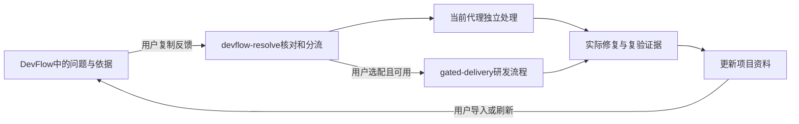

# 让监督发现进入研发闭环

DevFlow 帮你看到哪里缺依据、哪里失败、哪里需要介入。新的 `devflow-resolve` 技能把这些提示带回实际开发：先核实，再补需求、补资料、补测试或修代码，最后留下可以复查的结果。

## 分工与插拔

| 能力 | 负责什么 | 是否必需 |
| --- | --- | --- |
| DevFlow Mac 客户端 | 展示当前与历史资料，核对证据，整理反馈 | 接入已有反馈的来源；代理可在没有运行客户端时继续本地开发 |
| [devflow-record](../skills/devflow-record/SKILL.md) | 持续生产需求、动作、测试与问题资料 | 可单独用，也可作为记录适配器；缺失不阻止问题处理 |
| [devflow-resolve](../skills/devflow-resolve/SKILL.md) | 核对问题、分类、在授权内处理、复验和回写 | 本次新增，独立具备最小工作流程 |
| gated-delivery 或项目现有研发方式 | 执行需求与任务、修复、检查和交付 | 沿用用户选择；gated-delivery 只有明确选配才加载 |



图中是当前可以执行的协作步骤，不代表 App 自动调用智能体。首次保持人工反馈通路；未来宿主可按相同输入/结果合同增加调用点。插件配置不是自动hook，也不是新增部署或发送权限。

## 两种使用方式

把整个 `skills/devflow-resolve/` 目录交给代理；支持 SKILL.md 的宿主可按自己的方式加载，不支持的代理直接读取入口及相对引用。只用这个目录就能工作，无需拷贝 DevFlow 仓库自身的 AGENTS.md。

**独立处理**，给它当前项目和反馈：

> 使用 devflow-resolve 核对这份 DevFlow 反馈，在当前项目授权范围内补充或修复。先读当前需求和证据，保留旧失败，执行真实检查并回写已有资料包。当前没有额外研发技能，请独立完成，并说明实际读回到了哪一层。

**与我们的研发技能结合**，额外明确选择和真实路径：

> 本次配合 gated-delivery，技能入口是“实际路径”。由 devflow-resolve 核对问题并对应目标，gated-delivery 作为研发主流程；复用现有台账，保留各自的合同与检查结论。可选工具缺失时说明缺口，不影响可以继续的工作，也不解除原有必要门禁。

`devflow-record` 已可用时，代理可以复用它记录结果；没有时，新技能也提供已有监督包的回写约定。不把“先装另一技能”设为前置条件。

## 项目开关怎样生效

可以只在这次对话里明确选择。希望固定配置时，复制 [配置示例](../skills/devflow-resolve/assets/devflow-integration.example.json)，显式交给技能或用 `--config` 传给辅助脚本：

```json
{
  "schemaVersion": 1,
  "enabled": true,
  "development": {
    "adapter": "standalone",
    "skillPath": null
  }
}
```

选择研发技能时，把 adapter 改为 `gated-delivery`，skillPath 填真实入口。文件存在不代表启用；配置只在显式使用时读取。停用整个扩展设 `enabled:false`；仅停用研发适配而继续问题处理，则选择 `standalone`。

不传配置时，明确调用新技能仍采用独立流程；不用这个技能时，原开发流程没有新增步骤。不会自动修改全局指令、研发技能本体、其他项目或宿主设置。若原项目本来强制某项检查，关闭插件不等于取消检查。

## 处理哪些问题

需求没有拆清楚，就补原话、假设、可观察标准与任务；缺证先找真实来源，无法补回过去的事实就重新执行；旧证据过期要基于当前要求复验；测试层级不足就补相应检查；真正的代码缺陷要保留失败、修复、回归与原因；环境阻塞单独说明。

代理不能见到红色就改代码，也不能把旧失败删除来做出全绿结果。比如当前验收已经被新执行覆盖，历史失败仍应保留，但无需再次派发同一修复。重复缺陷还应记录为什么前次没查到，并加最小有效检查。

结果至少让你看到每个目标“发现了什么、改了什么、新增哪些执行、验证到哪一层、还有什么缺口”。代码修改、测试通过、CLI读回与App实际查看是不同事实。

## 当前工具边界

新技能附 `prepare_review.py`，只整理明确提供的当前评估和监督包，输出待核实问题清单。它验证ID/状态并保存输入摘要，不执行命令、不修复代码、不写原包。禁用时不读项目输入；缺研发技能回退独立选择；已有输出不会被覆盖。实际命令见 [插拔合同](../skills/devflow-resolve/references/integration.md)。

清单 `review.json` 不是 App 的监督包，不能拿它替代 `devflow-supervision.json`。纯文本反馈也能由代理处理；没有CLI时可以继续授权开发，但不能宣称已机器核验。CLI与App关联会话的范围可能不同，反馈也可能过期，处理前必须核对。

gated-delivery 的机器计划与 DevFlow JSON 不是同一种协议，合同摘要、层级、计数和时间不能直接复制互填。适配步骤见 [可选研发适配](../skills/devflow-resolve/references/gated-delivery.md)。本轮提供的是可选文件协议和技能协作，不声称外部研发技能已经内置自动插件系统。
